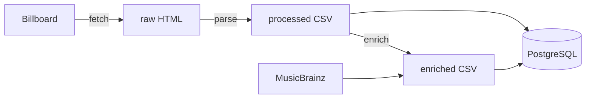

# Chart Pipeline

Fetches the Billboard Hot 100 each week, parses it into validated structured data, enriches it with MusicBrainz metadata, and loads it into PostgreSQL. Runs weekly on GitHub Actions.

**Status:** Running weekly on GitHub Actions, with a Dockerfile, built in CI, for a reproducible environment. Four chart weeks collected so far, the most recent loaded without me touching anything.

---

## The question

What identifiable traits such as genre, song length, solo versus collaboration are trending in hit music?

## Architecture



Raw HTML is saved to disk before any parsing so the parser can be iterated on offline against data already captured, without re-requesting the page. Past weeks cannot be re-fetched once a chart rolls over.

Enrichment writes each matched row to disk immediately rather than holding results in memory, and skips ranks already present in the output file on a rerun. A crash costs one song, not the whole run.

## Running it

**1. Clone the repo**

```bash
git clone https://github.com/adamsc94/chart-pipeline.git
cd chart-pipeline
```

**2. Set up the virtual environment and install dependencies**

```bash
python3 -m venv .venv
source .venv/bin/activate
pip install -r requirements.txt
```

Activation is per-session; you must run `source .venv/bin/activate` again in each new terminal. On Windows the command is `.venv\Scripts\activate`.

**3. Configure your environment**

```bash
cp .env.example .env
```

Then edit `.env`:

- `MB_CONTACT`: your email. MusicBrainz requires a descriptive User-Agent with a real contact address, and Billboard gets the same honest identification.
- `DATABASE_URL`: a PostgreSQL connection string. [Neon](https://neon.tech) has a free tier that's more than enough for this. The schema is created automatically on first load.

`.env` is gitignored and never committed.

**4. Run the pipeline**

```bash
python run_pipeline.py
```

That runs all four stages in order, passing each stage's output to the next. Takes about four minutes, almost all of it in enrichment. MusicBrainz asks for roughly one request per second, so the pipeline waits 2.5 seconds between calls.

Each stage can also be run on its own if you want to re-do one step:

```bash
python ingest/fetch_chart.py
python ingest/parse_chart.py data/raw/hot100_2026-10-31.html
python enrich/match_recordings.py data/processed/hot100_2026-10-31.csv
python load/load_db.py hot100_2026-10-31.csv
```

### Running with Docker

Instead of steps 2 and 4, you can build the image and run the pipeline in a container. You still need the `.env` from step 3.

```bash
docker build -t chart-pipeline .
docker run --rm --env-file .env chart-pipeline
```

`.env` is excluded from the image by `.dockerignore`, so credentials are passed in at run time rather than baked in. The container's `data/` directory is discarded when it exits; add `-v "$(pwd)/data:/app/data"` to keep the raw HTML and CSVs on your machine.

[`.github/workflows/build.yml`](.github/workflows/build.yml) builds the image on every push to confirm it still builds. The weekly scheduled run doesn't use it yet; it installs Python directly on the runner.

## Scheduling

[`.github/workflows/weekly.yml`](.github/workflows/weekly.yml) runs the pipeline every Wednesday at 16:00 UTC, on GitHub's runners rather than my laptop. `MB_CONTACT` and `DATABASE_URL` are stored as repository secrets.

A scheduled run gets a fresh machine that is destroyed afterwards, which is why the database is hosted rather than local. See [DECISIONS 011](docs/DECISIONS.md).

First scheduled run completed 4 November 2026; the Actions tab shows the run history.

## Output

**`chart_entries`**: one row per charting song, per week. `(chart_date, rank)` is the primary key, so re-running a load overwrites rather than duplicating.

| Column | Type | Notes |
|---|---|---|
| `chart_date` | date | The chart's own week, parsed from the page |
| `rank` | int | 1-100 |
| `title` | text | |
| `artist` | text | Raw credit string, not split. See DECISIONS 008 |
| `last_week` | int or null | Null for debuts and re-entries, since rank 0 does not exist |
| `peak` | int | Best position reached |
| `weeks_on_chart` | int | |
| `weeks_at_no_1` | int | 0 for songs that never topped the chart |
| `mb_recording_id` | text or null | Links to `recordings`; null when no match was found |

**`recordings`**: one row per MusicBrainz recording, stored once no matter how many weeks a song charts.

| Column | Type | Notes |
|---|---|---|
| `mb_recording_id` | text | MusicBrainz ID, primary key |
| `title` | text | MusicBrainz's title, which often differs from Billboard's |
| `artist_credit` | text | All credited artists |
| `length_ms` | int or null | |
| `first_release_date` | text or null | Text, since MusicBrainz dates are sometimes just a year |
| `isrc` | text or null | Industry recording identifier |

Example queries live in [`analysis/`](analysis/).

## Data sources

| Source | What it provides | Access | Constraints |
|---|---|---|---|
| Billboard | Weekly chart positions | Scraped, no official API | robots.txt permits `/charts/`; one request per week, honest User-Agent |
| MusicBrainz | Recording metadata, ISRCs, tags | Free, no key | ~1 req/sec; descriptive User-Agent required |

Collected data is not redistributed. `data/` is gitignored, so this repo holds the code that fetches the charts, not a copy of them.

## Known limitations

- The parser depends on Billboard's current CSS class names, so a redesign will break it, but a break fails loudly rather than by silently producing the wrong data. It validates structure before extracting values and raises an exception rather than writing bad rows. This has already happened once: Billboard changed their layout between September and October, and the validation caught it. See DECISIONS 010.
- Some songs carry an additional column, "weeks at no. 1", that the others do not. To handle this, I look up stat values by label rather than by position. See DECISIONS 009.
- Matching runs 91–94%. The same handful of songs fail every week, so the failures are deterministic rather than flaky. These might be worth investigating later.
- Unmatched songs aren't written to the enriched CSV, so a resumed run re-queries them. Fixing this properly means a status column recording why each song failed.
- Mix-level duplication in MusicBrainz is resolved by heuristic, not solved. See DECISIONS 003.
- Genre tags from MusicBrainz are sparse, often one or two votes per recording, so the genre question isn't well served yet.
- Scheduled runs are best-effort on GitHub’s free runners. The first scheduled run fired 5 hours and 42 minutes after its cron time. This doesn’t affect data quality, since the chart doesn’t change during the day, but a run could in principle be skipped, which would cost a week permanently.
- Scheduled runs discard their `data/` directory when the machine is destroyed, so the raw HTML only persists for local runs.

## Decisions

Every significant design choice is logged in [docs/DECISIONS.md](docs/DECISIONS.md) with the reasoning and the tradeoff.

## Roadmap

- **Deeper enrichment.** The matcher currently uses only what MusicBrainz's search endpoint returns. Their lookup endpoint can also provide community genre tags, artist attributes such as country of origin and whether the act is a person or a group, and relationship data covering producers and writers. Each costs an extra API call per song, so I'm holding off on it for now.
