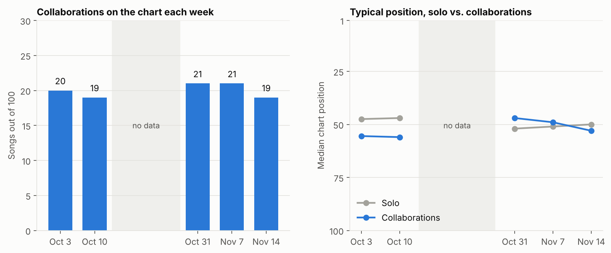
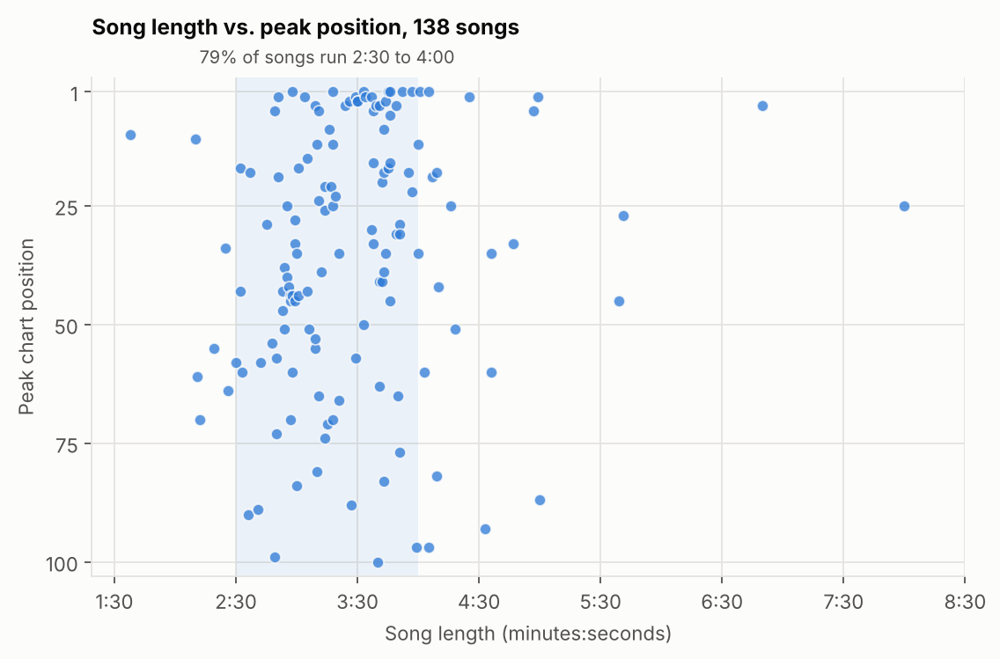
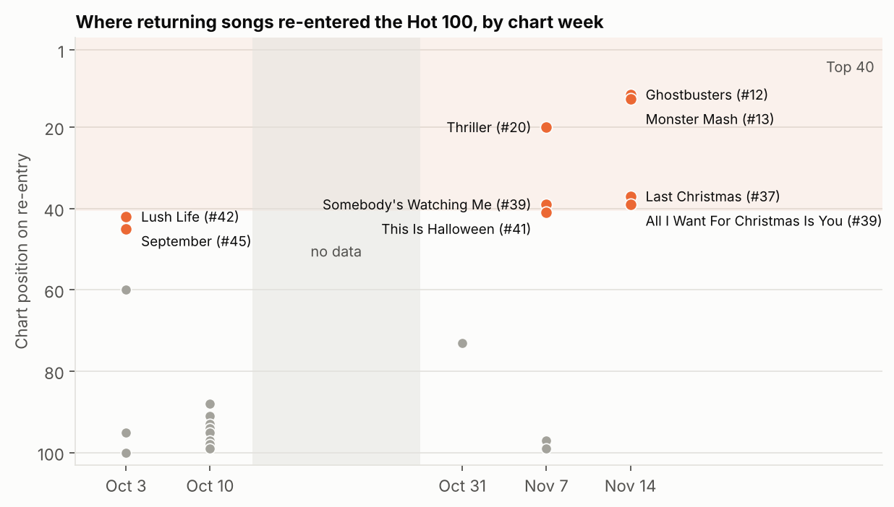
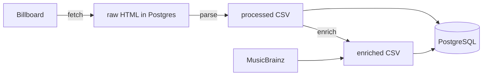

# Chart Pipeline

Fetches the Billboard Hot 100 each week, parses it into validated structured data, enriches it with MusicBrainz metadata, and loads it into PostgreSQL. Runs weekly on GitHub Actions.

**Status:** Running weekly on GitHub Actions, with a Dockerfile, built in CI, for a reproducible environment. Five chart weeks collected so far, the most recent loaded without me touching anything.

---

## The question

What identifiable traits such as genre, song length, solo versus collaboration are trending in hit music?

## Findings

Five chart weeks so far (Oct 3, Oct 10, Oct 31, Nov 7 and Nov 14, 2026), 153 distinct songs. These are what the data can support at that size. Each one has a query in [`analysis/`](analysis/), and [`analysis/make_charts.py`](analysis/make_charts.py) redraws the charts from the database.

### 1. About one in five Hot 100 songs is a collaboration, and they don't chart any higher than solo songs



Collaborations held 19 to 21 of the 100 slots in every week collected. They show no advantage in position. In two of the five weeks the typical collaboration sat above the typical solo song, and in the other three it sat below. Counting each song once, collaborations peaked a little lower (median peak 42, against 29 for solo songs), but with only 33 collaborations that gap is too small to claim. Query: [`01_collaborations.sql`](analysis/01_collaborations.sql).

Further analysis could probe how the share of collaborations vs solo has changed over time.

### 2. Song length says almost nothing about chart position



Of the 138 songs with a known length, 79% run between 2:30 and 4:00, and the median is 3:22. Inside that narrow range, length doesn't predict rank. The correlation between length and rank within a single week runs from -0.04 to -0.18, which is close to none. Against a song's all-time peak there is a weak lean toward longer songs (-0.21). I wouldn't build anything on it. Query: [`02_song_length.sql`](analysis/02_song_length.sql).

An additional interesting question in this domain might be to see how the average song length on the billboard compares to an average non-billboard song, although we would need to be careful to define what an "average" song is and how we would collect that data. 

### 3. Songs that return to the chart usually come back near the bottom. Around Halloween they came back in the top 40



The chart changes slowly. Between consecutive weeks, 86 to 91 of the 100 songs carried over, and the typical song on the chart had been there 11 to 14 weeks. A song that drops off and returns normally re-enters low. On the Oct 10 and Oct 31 charts, all nine re-entries landed at #73 or lower. The charts dated Nov 7 and Nov 14, which cover the days around Halloween, look different. Six of their nine re-entries landed in the top 40, among them "Thriller" at #20 (it reached #2 a week later), "Ghostbusters" at #12 and "Monster Mash" at #13. Two Christmas songs were already back by Nov 14. Query: [`03_reentries.sql`](analysis/03_reentries.sql).

### Limitations

- **Five weeks is not much.** These describe October and November 2026 and nothing wider. Finding 3 rests on 23 re-entries and a single Halloween.
- **There is a gap.** The charts dated Oct 17 and Oct 24 were never collected and can't be fetched now. Week-to-week numbers use only the three pairs of back-to-back weeks. Re-entries are read from Billboard's own "last week" field, so the gap can't invent one, but any that happened during the gap are missing.
- **Length depends on the MusicBrainz match.** 90 to 94 songs match each week, and 15 songs never matched, including "Thriller" and "Monster Mash". Unmatched songs are spread across the chart and not bunched at one end. Four matches look like a different version of the song (a remix or an extended cut), and leaving them out moves the correlations by 0.02 at most. Findings 1 and 3 use only Billboard's fields, so match errors can't touch them.
- **Release dates were not used.** MusicBrainz's `first_release_date` is wrong often enough to mislead. Rockwell's "Somebody's Watching Me", from 1984, is dated 2025. That ruled out measuring how old the returning songs are, so calling them Halloween songs is my reading of the titles and not something the data labels.
- **A song is a title plus an artist string.** When a credit changes, the song splits in two. "Expectations" charted as Olivia Rodrigo, then as Olivia Rodrigo & Chappell Roan, and counts once as solo and once as a collaboration.
- **"Weeks on chart" is a lifetime total.** It includes earlier runs, so "All I Want For Christmas Is You" shows 80 weeks. It says how long a song has charted in total, not how long its current run has lasted.

The checks behind these caveats are in [`analysis/pressure_tests.sql`](analysis/pressure_tests.sql).

## Architecture



Raw HTML is stored gzipped in Postgres (`raw_charts`) before any parsing, and the parser reads the page back from there rather than re-requesting it. Past weeks cannot be re-fetched once a chart rolls over, so this is the only record of each week's page. A copy is also written to `data/raw/` as a backup, but nothing reads it. See DECISIONS 016.

Enrichment writes each matched row to disk immediately rather than holding results in memory, and skips ranks already present in the output file on a rerun. A crash costs one song, not the whole run.

## Running it

**1. Clone the repo**

```bash
git clone https://github.com/adamsc94/chart-pipeline.git
cd chart-pipeline
```

**2. Set up the virtual environment and install dependencies**

```bash
python3 -m venv .venv
source .venv/bin/activate
pip install -r requirements.txt
```

Activation is per-session; you must run `source .venv/bin/activate` again in each new terminal. On Windows the command is `.venv\Scripts\activate`.

**3. Configure your environment**

```bash
cp .env.example .env
```

Then edit `.env`:

- `MB_CONTACT`: your email. MusicBrainz requires a descriptive User-Agent with a real contact address, and Billboard gets the same honest identification.
- `DATABASE_URL`: a PostgreSQL connection string. [Neon](https://neon.tech) has a free tier that's more than enough for this. The schema is created automatically on first load.

`.env` is gitignored and never committed.

**4. Run the pipeline**

```bash
python run_pipeline.py
```

That runs all four stages in order, passing each stage's output to the next. Takes about four minutes, almost all of it in enrichment. MusicBrainz asks for roughly one request per second, so the pipeline waits 2.5 seconds between calls.

Each stage can also be run on its own if you want to re-do one step:

```bash
python -m ingest.fetch_chart
python -m ingest.parse_chart   # parses the most recently stored page
python enrich/match_recordings.py data/processed/hot100_2026-10-31.csv
python load/load_db.py hot100_2026-10-31.csv
```

### Running with Docker

Instead of steps 2 and 4, you can build the image and run the pipeline in a container. You still need the `.env` from step 3.

```bash
docker build -t chart-pipeline .
docker run --rm --env-file .env chart-pipeline
```

`.env` is excluded from the image by `.dockerignore`, so credentials are passed in at run time rather than baked in. The container's `data/` directory is discarded when it exits; add `-v "$(pwd)/data:/app/data"` to keep the raw HTML and CSVs on your machine.

[`.github/workflows/build.yml`](.github/workflows/build.yml) builds the image on every push to confirm it still builds. The weekly scheduled run doesn't use it yet; it installs Python directly on the runner.

## Scheduling

[`.github/workflows/weekly.yml`](.github/workflows/weekly.yml) runs the pipeline every Wednesday at 16:00 UTC, on GitHub's runners rather than my laptop. `MB_CONTACT` and `DATABASE_URL` are stored as repository secrets.

A scheduled run gets a fresh machine that is destroyed afterwards, which is why the database is hosted rather than local. See [DECISIONS 011](docs/DECISIONS.md).

First scheduled run completed 4 November 2026; the Actions tab shows the run history.

## Output

**`chart_entries`**: one row per charting song, per week. `(chart_date, rank)` is the primary key, so re-running a load overwrites rather than duplicating.

| Column | Type | Notes |
|---|---|---|
| `chart_date` | date | The chart's own week, parsed from the page |
| `rank` | int | 1-100 |
| `title` | text | |
| `artist` | text | Raw credit string, not split. See DECISIONS 008 |
| `last_week` | int or null | Null for debuts and re-entries, since rank 0 does not exist |
| `peak` | int | Best position reached |
| `weeks_on_chart` | int | |
| `weeks_at_no_1` | int | 0 for songs that never topped the chart |
| `mb_recording_id` | text or null | Links to `recordings`; null when no match was found |

**`recordings`**: one row per MusicBrainz recording, stored once no matter how many weeks a song charts.

| Column | Type | Notes |
|---|---|---|
| `mb_recording_id` | text | MusicBrainz ID, primary key |
| `title` | text | MusicBrainz's title, which often differs from Billboard's |
| `artist_credit` | text | All credited artists |
| `length_ms` | int or null | |
| `first_release_date` | text or null | Text, since MusicBrainz dates are sometimes just a year |
| `isrc` | text or null | Industry recording identifier |

**`raw_charts`**: one row per fetch, holding the page exactly as Billboard served it.

| Column | Type | Notes |
|---|---|---|
| `fetched_at` | timestamp | When the page was fetched, primary key |
| `url` | text | The page fetched |
| `html_gz` | bytes | The page, gzipped. About 220 KB a week |
| `chart_date` | text or null | Filled in once the chart date is read from the page; null means it couldn't be read |

Example queries live in [`analysis/`](analysis/).

## Data sources

| Source | What it provides | Access | Constraints |
|---|---|---|---|
| Billboard | Weekly chart positions | Scraped, no official API | robots.txt permits `/charts/`; one request per week, honest User-Agent |
| MusicBrainz | Recording metadata, ISRCs, tags | Free, no key | ~1 req/sec; descriptive User-Agent required |

Collected data is not redistributed. `data/` is gitignored, so this repo holds the code that fetches the charts, not a copy of them.

## Known limitations

- The parser depends on Billboard's current CSS class names, so a redesign will break it, but a break fails loudly rather than by silently producing the wrong data. It validates structure before extracting values and raises an exception rather than writing bad rows. This has already happened once: Billboard changed their layout between September and October, and the validation caught it. See DECISIONS 010.
- Some songs carry an additional column, "weeks at no. 1", that the others do not. To handle this, I look up stat values by label rather than by position. See DECISIONS 009.
- Matching runs 91–94%. The same handful of songs fail every week, so the failures are deterministic rather than flaky. These might be worth investigating later.
- Unmatched songs aren't written to the enriched CSV, so a resumed run re-queries them. Fixing this properly means a status column recording why each song failed.
- Mix-level duplication in MusicBrainz is resolved by heuristic, not solved. See DECISIONS 003.
- Genre tags from MusicBrainz are sparse, often one or two votes per recording, so the genre question isn't well served yet.
- Scheduled runs are best-effort on GitHub’s free runners. The first scheduled run fired 5 hours and 42 minutes after its cron time. This doesn’t affect data quality, since the chart doesn’t change during the day, but a run could in principle be skipped, which would cost a week permanently.
- Each run parses only the page it just fetched. `chart_date` in `raw_charts` shows that the date was read, not that the songs parsed, and nothing goes back to re-parse a stored page that failed. The five pages fetched before `raw_charts` existed were backfilled with their file modification time as an approximate `fetched_at`. See DECISIONS 016.

## Decisions

Every significant design choice is logged in [docs/DECISIONS.md](docs/DECISIONS.md) with the reasoning and the tradeoff.

## Roadmap

- **Deeper enrichment.** The matcher currently uses only what MusicBrainz's search endpoint returns. Their lookup endpoint can also provide community genre tags, artist attributes such as country of origin and whether the act is a person or a group, and relationship data covering producers and writers. Each costs an extra API call per song, so I'm holding off on it for now.
